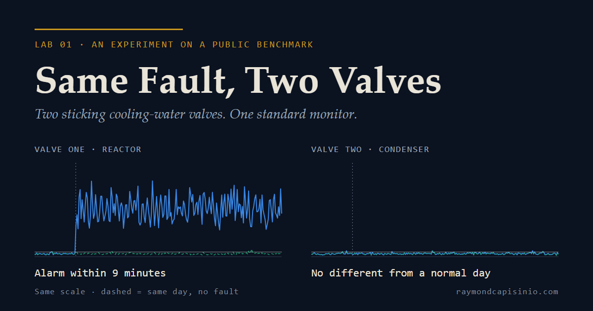

# Same Fault, Two Valves

**LAB 01 · An experiment on a public benchmark**



Two cooling-water valves start sticking at 08:00 on a simulated chemical plant, the Tennessee
Eastman process. A standard PCA process monitor raises an alarm on one within 9 minutes. The
other, it cannot tell apart from a normal day.

**Read the write-up, with interactive charts:** https://raymondcapisinio.com/lab/same-fault-two-valves/

This repository is the full pipeline behind it: download, measurement, an independent re-check,
and the page build. Every number in the write-up comes from this code.

## The result

The same fault (a sticking valve, "stiction") on two valves, 20 test runs each, scored from 08:00
to the end of the two-day run.

| | Samples flagged after 08:00 | Runs that raised an alarm |
|---|---:|---:|
| Valve one: reactor cooling water (fault 14) | 99.98% | 20 of 20 |
| Valve two: condenser cooling water (fault 15) | 2.34% | 8 of 20 |
| The same 20 runs with no fault (their twins) | | 5 of 20 |
| Normal running, 500 unseen runs | 2.05% | |

Every faulty test run in this dataset has a normal twin: it matches a fault-free run value for
value until 08:00, when the fault switches on. That makes a clean comparison: the same day, with
and without the fault. `06_export_page.py` checks the twins before it exports anything.

## Try to beat it

Valve two is the hard one. The test set is the 20 fault-15 runs and their 20 normal twins. This
monitor alarms on 8 of the faulty runs and on 5 of the twins, which is almost no
separation. Du and Du (2018, below) report detecting this fault from the same kind of process
data, with a method built for faults like it. If you run
one on these 40 runs and separate them, I would like to see it: open an issue, or write to
hello@raymondcapisinio.com.

## Run it yourself

About 3 minutes after the downloads, about 0.4 GB of memory at peak, no paid services. Tested on
Python 3.14 on Windows.

```bash
python -m pip install -r requirements.txt
cd pipeline
python 01_download.py fault-free        # 72 MB, checksum-verified, licence text re-read
python 01_download.py faulty-testing    # 837 MB
python 02_extract.py --check            # own streaming reader vs the rdata reference reader
python 02_extract.py                    # -> data/parquet/
python 03_measure.py                    # -> out/measurements.csv, out/monitor.json
python 04_recheck.py                    # a separate implementation; must PASS
python 05_sensitivity.py                # -> out/sensitivity.csv
python 06_export_page.py                # -> out/page_data.json
python 07_build_page.py                 # -> page/index.html
python 09_og_card.py                    # -> page/og-card.png (needs: python -m playwright install chromium)
```

The results from my run are already in `out/`, so you can check them against yours.
`08_render_check.py` screenshots the page in a browser; the page takes its styling from the
website it is published on, which is not part of this repository.

## How the numbers are kept honest

- **Nothing typed by hand.** `07_build_page.py` fills every number in the write-up from `out/`.
- **Sentences are tested.** The build refuses to finish if the data no longer supports a sentence
  the write-up makes (for example "all 20 runs alarmed").
- **Measured twice.** `04_recheck.py` recomputes every quoted number a different way (SVD instead
  of an eigendecomposition, rolling windows instead of a loop, group-bys instead of arrays).
- **The reader is checked.** The 837 MB R data file is read by a small streaming reader written
  for this (`rstream.py`). `02_extract.py --check` compares it with the `rdata` reference reader,
  value for value, on both normal-running files.
- **The tuning is swept.** `05_sensitivity.py` reruns the monitor at 80, 90 and 95% of the
  variance and at a 99.9% limit. The picture does not change.

## The monitor

PCA on the 52 standardised recorded values (41 measurements, 11 controller outputs), fitted to
250,000 samples of normal operation: 31 components (90.1% of the variance), Hotelling T² and
SPE limits at 99%. A sample is flagged when either statistic crosses its limit. An alarm is three
flags in a row, timed at the third. On normal running it flags 1.95% of samples.

## Layout

```
pipeline/   01-09 run in order; rstream.py (R file reader), tags.py (names), probe_fault15.py
out/        measured results (CSV and JSON)
page/       template.html, the write-up with the placeholders that 07 fills
docs/       the image above
```

## How this was made

I wrote the pipeline with an AI coding assistant, to my specification. Every number comes from
that code and its separate re-check.

## Not claimed

This is a simulation, not a plant, and it tests one kind of monitor. The two field notes in the
write-up are fiction, and labelled as such. Neither the dataset's authors nor Pacific Science &
Engineering Group reviewed or endorse this work.

## Sources

- Data: Rieth, Amsel, Tran, Cook (2017), *Additional Tennessee Eastman Process Simulation Data
  for Anomaly Detection Evaluation*, Harvard Dataverse, [doi:10.7910/DVN/6C3JR1](https://doi.org/10.7910/DVN/6C3JR1).
  Public domain. Not included here: `01_download.py` fetches it and verifies each file's checksum.
- Process: Downs and Vogel (1993), *A plant-wide industrial process control problem*, Computers
  & Chemical Engineering 17(3).
- Names of the recorded values and faults: N. L. Ricker, [Tennessee Eastman Challenge Archive](https://depts.washington.edu/control/LARRY/TE/download.html).
- Fault classes: Sun, Paiva, Xu, Sundaram, Braatz (2020), [arXiv:1911.04386](https://arxiv.org/abs/1911.04386).
- Faults most methods miss: Du and Du (2018), [ADCHEM](https://skoge.folk.ntnu.no/prost/proceedings/ADCHEM-2018/media/files/0146.pdf).

## Licence

Code: MIT, see [LICENSE](LICENSE). The dataset keeps its own terms (public domain).

Raymond P. Capisinio · [raymondcapisinio.com](https://raymondcapisinio.com)
